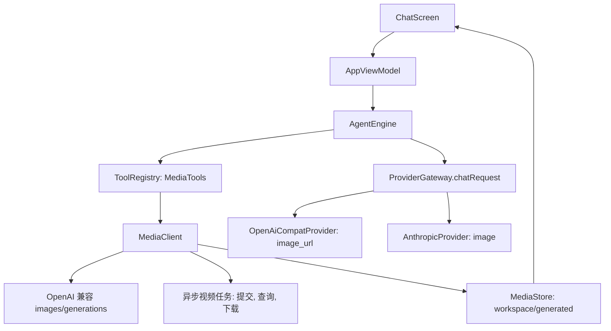

# 生图与视频模型适配

Feature Name: image-video-generation
Updated: 2026-10-28

## Description

聊天主模型保持不变。生图与视频以 Agent 工具的形式提供：`image_generate`、`video_generate`、`video_status`。工具读取当前提供商的媒体配置，调用厂商接口，把结果保存到工作区 `generated` 目录，并在工具结果里返回文件路径。聊天界面解析工具结果中的路径，显示图片缩略图与视频卡片。聊天输入增加图片附件，请求体按提供商类型组装 `image_url` 或 `image` 内容块。

## Architecture



数据流：Agent 选择工具后，权限层按 MEDIUM 风险审批，`MediaClient` 发出请求，`MediaStore` 落盘并返回路径，工具结果以 `FILE:` 前缀行携带路径，聊天界面解析后渲染。

## Components and Interfaces

### MediaTools（`tools/MediaTools.kt`，新增）

- `imageGenerate`：参数 `prompt`（必填）、`size`（默认 1024x1024）、`n`（默认 1，上限 4）。
- `videoGenerate`：参数 `prompt`（必填）、`image_path`（可选，图生视频）、`duration`（可选，秒）。返回任务 ID。
- `videoStatus`：参数 `task_id`。状态为 succeeded 时下载视频并返回路径。
- 三个工具的 `risk` 均为 `ToolDef.Risk.MEDIUM`。
- `MediaTools.all` 由 `AgentEngine` 与 `SettingsScreen` 的工具列表一并装配，工具名加入 `AppSettings.defaultTools()`。

### MediaClient（`provider/MediaClient.kt`，新增）

```kotlin
object MediaClient {
    suspend fun generateImages(p: ProviderConfig, prompt: String, size: String, n: Int): Result<List<ByteArray>>
    suspend fun submitVideo(p: ProviderConfig, prompt: String, imageBase64: String?, duration: Int?): Result<String>
    suspend fun queryVideo(p: ProviderConfig, taskId: String): Result<VideoTask>
    suspend fun download(url: String): Result<ByteArray>
}

data class VideoTask(val status: VideoStatus, val videoUrl: String?, val error: String?)
enum class VideoStatus { PENDING, RUNNING, SUCCEEDED, FAILED }
```

- 图片接口默认地址为 `baseUrl + /v1/images/generations`，`imageEndpoint` 非空时以该地址为准。
- 响应解析同时支持 `data[].url` 与 `data[].b64_json`。
- 视频使用 `videoSubmitUrl` 与 `videoStatusUrl`（支持 `{{task_id}}` 占位），字段路径使用与 `PluginExecutor` 一致的点路径规则。
- 请求使用 `LlmClient`，Authorization 头为 `Bearer apiKey`。

### MediaStore（`tools/MediaStore.kt`，新增）

- `save(bytes, ext): File`：写入 `workspaceRoot()/generated/<yyyyMMdd-HHmmss>-<序号>.<ext>`，返回文件。
- 扩展名依据魔数判断（PNG、JPEG、WEBP、MP4），无法判断时使用 png 与 mp4 作为默认。
- 工具结果格式：首行说明，之后每个文件一行 `FILE:<相对工作区的路径>`。

### ModelRegistry 扩展

- `ModelMeta` 增加 `kind: ModelKind = ModelKind.CHAT`，`ModelKind` 取值 CHAT、IMAGE、VIDEO。
- 新增规则：image、cogview、wanx、seedream、dall-e、flux 映射为 IMAGE；video、cogvideo、seedance、veo、kling 映射为 VIDEO。规则排在聊天模型规则之前。
- 模型选择器过滤 `kind != CHAT` 的模型。

### 提供商层图片输入

- `ChatTurn` 增加 `images: List<ImagePart> = emptyList()`，`ImagePart(mime: String, base64: String)`。
- `OpenAiCompatProvider.chatRequest`：用户消息含图片时，`content` 改为数组，元素为 `{type:text}` 与 `{type:image_url, image_url:{url:data:mime;base64,...}}`。
- `AnthropicProvider.chatRequest`：`content` 数组加入 `{type:image, source:{type:base64, media_type, data}}`。
- `OllamaProvider`：写入 `images` 数组（纯 base64 字符串）。

### 界面层

- `ChatScreen` 输入栏增加附件按钮，使用 `GetContent("image/*")`，缩略图预览条带移除按钮。图片压缩到长边 1568px、JPEG 质量 85 后再编码。
- 工具卡片解析 `FILE:` 行：图片显示缩略图，点击进入全屏查看；视频显示封面（`MediaMetadataRetriever` 取首帧）与播放按钮，点击通过 `FileProvider` 与 `ACTION_VIEW` 调用系统播放器。
- `ProvidersScreen` 的提供商编辑对话框增加「媒体模型」分组：生图模型、视频模型、图片接口地址、视频提交地址、视频查询地址、任务 ID 路径、状态路径、结果地址路径、成功状态值。

## Data Models

`ProviderConfig` 新增字段，全部带默认值，旧数据反序列化兼容：

```kotlin
val imageModel: String = ""
val videoModel: String = ""
val imageEndpoint: String = ""
val videoSubmitUrl: String = ""
val videoStatusUrl: String = ""
val videoTaskIdPath: String = "id"
val videoStatusPath: String = "status"
val videoResultPath: String = "video_url"
val videoSuccessValues: List<String> = listOf("succeeded", "success", "completed")
val videoFailValues: List<String> = listOf("failed", "error", "cancelled")
```

`Message` 新增 `images: List<String> = emptyList()`，保存附件在 `filesDir/attachments/` 下的文件名，会话重载后仍能显示缩略图。发送时按文件名读取并编码为 `ImagePart`。

## Correctness Properties

1. 同一次工具调用保存的文件名唯一，连续两次调用不会覆盖已有文件。
2. 所有写入路径的 canonical 路径位于 `workspaceRoot()/generated` 之内，提示词与厂商返回的文件名不参与路径拼接。
3. 工具结果、日志与异常信息不含 `apiKey`；错误文本对响应体做截断并替换密钥串。
4. `video_status` 对同一已完成任务重复调用时，返回已保存的文件路径，不重复下载。
5. 图片附件的编码结果大小上限为 5 MB，超出时降低质量或缩小尺寸后重试。
6. 旧版 `settings.json` 与会话文件在缺少新字段时能正常加载。

## Error Handling

| 场景 | 处理 |
| --- | --- |
| 未配置生图或视频模型 | 返回 `ERROR: 当前提供商未配置生图模型，请到提供商设置中填写` |
| HTTP 非 2xx | 返回 `HTTP <code>: <响应前 500 字符>` |
| 网络异常 | 返回 `ERROR: <message>` |
| 响应缺少 url 与 b64_json | 返回 `ERROR: 响应中没有图片数据` 并附响应前 300 字符 |
| 视频任务失败 | 返回厂商给出的失败原因与任务 ID |
| 轮询超过 10 分钟 | 返回超时错误并保留任务 ID，用户可稍后再调用 `video_status` |
| 下载失败 | 返回错误并保留远程 URL，便于用户手动下载 |
| 模型不支持视觉 | 发送前提示，附件保留在输入栏 |

视频下载后厂商 URL 通常有时效，工具在 `succeeded` 时立即下载。

## Test Strategy

- 单元测试（JVM）：`MediaClient` 响应解析，覆盖 url、b64_json、缺字段三种；点路径提取；`ModelRegistry` 的 kind 规则与聊天模型规则的优先级；`MediaStore` 魔数判断与文件名唯一性。
- 请求体测试：`OpenAiCompatProvider` 与 `AnthropicProvider` 在有无图片时生成的 JSON 结构，对照厂商文档的字段名。
- 兼容测试：缺少新字段的旧 JSON 反序列化。
- 云端构建：每层提交后跑 `assembleDebug`，通过后进入下一层。
- 真机验证：生图落盘与缩略图显示、视频卡片与系统播放器、附件识图、深浅色主题下的卡片显示。

分层顺序：数据层与 ModelRegistry，提供商层与 MediaClient，工具层与权限，界面层，附件链路。

## References

[^1]: (ProviderGateway.kt) - [提供商路由](app/src/main/kotlin/ai/devcodex/agent/provider/ProviderGateway.kt)
[^2]: (ToolRegistry.kt) - [ToolDef 定义](app/src/main/kotlin/ai/devcodex/agent/agent/ToolRegistry.kt)
[^3]: (BuiltinTools.kt#L360) - [workspaceRoot](app/src/main/kotlin/ai/devcodex/agent/tools/BuiltinTools.kt)
[^4]: (PluginExecutor.kt) - [点路径提取规则](app/src/main/kotlin/ai/devcodex/agent/plugin/PluginExecutor.kt)
